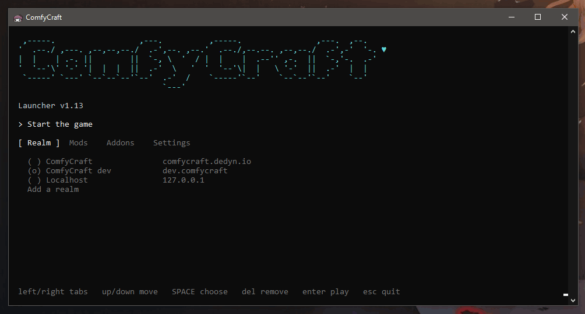

# ComfyLauncher

**Bugs, questions and screenshots: [join our Discord](https://discord.gg/uhefX2efB7).**

[](https://discord.gg/uhefX2efB7)

Little launcher project for smol server. Thanks for seeing.



## Install

1. [Download](https://github.com/aloofbit/comfylauncher/releases/latest) `ComfyLauncher.zip`
2. Extract into your WoW folder
3. Open `ComfyLauncher.exe`

### Mac

ComfyLauncher runs on Apple Silicon Macs inside [WoWSilicon](https://github.com/WoWSilicon/WoWSilicon). See [Install on a Mac](install-mac.md).

## Features

- Download/Install Mods
- Install Addons (git or zip)
- Addons repo search
- Realm choice
- Small File
- Works through Steam overlay
- Works on Linux through Proton or Wine
- Works on Mac through WoWSilicon
- Secret features :)

## Build

Install the [.NET SDK](https://dotnet.microsoft.com/download), then run:

```
dotnet build src\ComfyLauncher.csproj -c Release
```

The exe is in `src\bin\Release\net472\`.

## Inspiration

- [IchaLaunch](https://github.com/brutaliccus/IchaLaunch)
- [OctoWoW Installation Manager](https://github.com/zmarotrix/OctoWoW-Installation-Manager)
- TurtleWoW Launcher
- Octo Launcher
